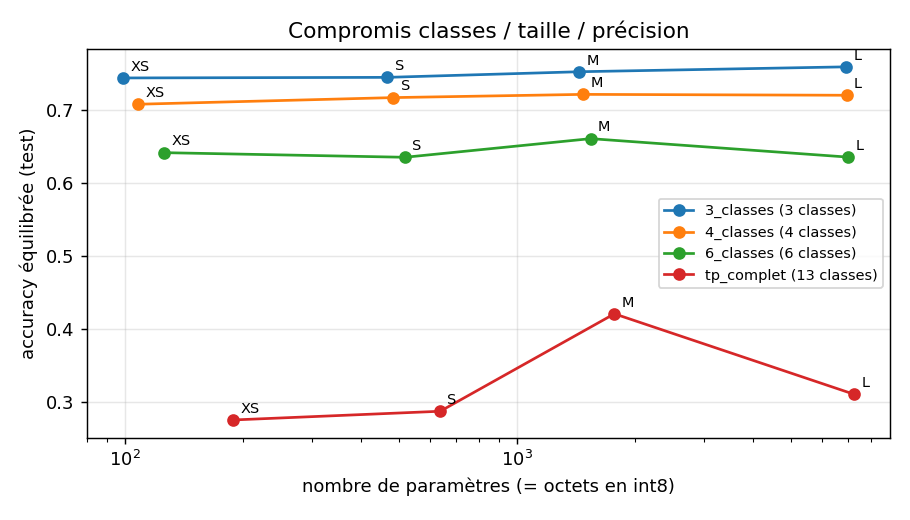

# TP3 – Démarche et choix de conception

Ce document retrace, étape par étape, les observations faites sur les données
et les choix qui en découlent pour le modèle de classification météo.

---

## 1. Données (Meteostat)

Source : historique horaire de la station **Chambéry–Aix (07491)**, la plus
proche du campus, de 2015 à 2025 (`ml/01_donnees.py`).

Chaque heure comporte des mesures (température, humidité, pression, vent,
précipitations…) et un code de condition météo `coco` (1 à 27 : clair,
couvert, brouillard, pluie, orage…). Ce code sert d'étiquette : c'est la
réponse que le modèle doit apprendre à retrouver.

### Observations

96 366 heures téléchargées. Valeurs manquantes :

| Colonne | Manquant | Mesurable par la carte |
|---|---|---|
| temp (température) | 0,1 % | oui (SHT40) |
| rhum (humidité) | 0,4 % | oui (SHT40) |
| pres (pression) | 0,1 % | oui (LPS22DF) |
| vent, précipitations, ensoleillement, nébulosité | 0 à 100 % | non (pas de capteur) |
| coco (étiquette) | 25,7 % | – |

Il reste environ **71 500 heures étiquetées**.

La répartition des étiquettes est très déséquilibrée : « Couvert » représente
42 % des heures. Les conditions rares (neige ≈ 420 h, tempête 53 h, orage
violent 17 h sur 11 ans) ont trop peu d'exemples pour être apprises. Le code 0
(228 h), hors de la nomenclature officielle, est ignoré.

### Choix

Les entrées du modèle se limitent aux grandeurs mesurables par la carte
(température, humidité, pression) et à des grandeurs calculées à partir
d'elles. Un modèle utilisant le vent ou la nébulosité ne pourrait pas être
déployé sur le prototype.

---

## 2. Classes (regroupement des codes `coco`)

Les 27 codes sont regroupés en quelques classes. Certains codes sont trop rares,
d'autres sont indiscernables avec nos capteurs (la tempête nécessite un
anémomètre).

**Schéma à 3 classes**

| Classe | Codes coco | Part des heures |
|---|---|---|
| Clair | 1, 2 | 17 % |
| Nuageux | 3, 4, 5 | 62 % |
| Précipitations | 7 à 27 | 21 % |

Chaque classe dispose de milliers d'exemples. Limite : un classifieur qui
répond toujours « Nuageux » obtient déjà 62 % de bonnes réponses. Cette
référence sert de seuil minimal pour juger le modèle.

**Schéma à 4 classes** : le brouillard devient une classe à part.

| Classe | Codes coco | Part des heures |
|---|---|---|
| Clair | 1, 2 | 17 % |
| Nuageux | 3, 4 | 53 % |
| Brouillard | 5, 6 | 9 % |
| Précipitations | 7 à 27 | 21 % |

Le brouillard correspond à un air saturé (humidité ≈ 100 %), donc
directement observable avec le capteur d'humidité.

Les deux schémas, ainsi que des variantes à 6 et 13 classes (liste complète du
sujet), sont comparés expérimentalement (question 3.1b). Le choix final repose
sur ces mesures.

---

## 3. Entrées du modèle

Des entrées supplémentaires sont calculées à partir des mesures et de la date,
sans capteur supplémentaire (`ml/meteo_features.py`). Les mêmes formules
doivent être appliquées dans MATLAB et sur la carte.

| Entrée | Calcul | Justification |
|---|---|---|
| temp, rhum | SHT40 | mesures de base |
| pres | LPS22DF, ramenée au niveau de la mer | Meteostat fournit la pression au niveau de la mer ; à 235 m la carte mesure ≈ 28 hPa de moins |
| ecart_rosee | température − point de rosée (formule de Magnus) | un écart proche de 0 indique un air saturé (brouillard, pluie) |
| heure_sin, heure_cos | heure UTC en coordonnées sur un cercle | le brouillard est surtout nocturne et matinal |
| jour_sin, jour_cos | jour de l'année en coordonnées sur un cercle | effet des saisons (neige, orages, brouillard d'automne) |
| dp3h | pression actuelle − pression 3 h avant | une baisse de pression annonce une dégradation |

**Codage cyclique (sinus, cosinus).** L'heure et le jour sont cycliques : 23 h
précède 0 h, le 31 décembre précède le 1er janvier. Codés par un seul nombre,
ils paraîtraient éloignés (23 contre 0). On les représente par la position
d'un point sur un cercle, (cos θ, sin θ), avec θ = 2π·heure/24 (ou
2π·jour/365,25). Deux instants proches dans le cycle ont alors des
coordonnées proches.

**Contraintes induites sur le prototype**

- Heure et jour : la carte doit connaître la date et l'heure (synchronisation
  SNTP).
- dp3h : il faut 3 h de mesures avant la première prédiction. Pistes :
  récupérer l'historique sur ThingSpeak, ou ne pas utiliser cette entrée.

Quatre jeux d'entrées sont comparés : mesures seules, + point de rosée,
+ heure et saison, + tendance de pression.

---

## 4. Premier entraînement (3 classes, réseau S, entrées « temps »)

Réseau : 8 entrées → 16 → 16 → 3 sorties, **467 paramètres** (≈ 470 octets
en int8). 53 530 heures d'entraînement (2015–2023), 8 784 de validation
(2024), 8 760 de test (2025). Arrêt précoce à l'époque 23 ; poids restaurés
à l'époque 11 (meilleure perte de validation).

### Résultats sur l'année de test (2025)

| Indicateur | Valeur |
|---|---|
| Accuracy | 61,1 % |
| Accuracy équilibrée | 74,5 % |
| Référence « toujours Nuageux » (accuracy) | 70,5 % |
| Référence « toujours Nuageux » (accuracy équilibrée) | 33,3 % |

| Classe réelle | Rappel | Prédite Clair | Prédite Nuageux | Prédite Précip. |
|---|---|---|---|---|
| Clair (1 227 h) | **90,5 %** | 0,91 | 0,05 | 0,04 |
| Nuageux (6 178 h) | **50,7 %** | 0,20 | 0,51 | 0,29 |
| Précipitations (1 355 h) | **82,2 %** | 0,05 | 0,13 | 0,82 |

Précision estimée à partir de la matrice (part des prédictions correctes) :
Clair ≈ 46 %, Nuageux ≈ 93 %, Précipitations ≈ 38 %.

### Analyse

- Le modèle a appris une relation réelle : il reconnaît 9 heures claires sur
  10 et 8 heures de précipitations sur 10, là où la référence n'en reconnaît
  aucune.
- Son accuracy brute (61 %) est inférieure à la référence (70,5 %). C'est un
  effet des **poids de classes** : le modèle est poussé à détecter les classes
  rares, au prix de nombreuses erreurs sur « Nuageux ». Il en résulte beaucoup
  de **fausses alertes** : seule une prédiction « Précipitations » sur trois
  environ est correcte.
- La confusion principale est Nuageux ↔ Précipitations : un ciel couvert et une
  pluie faible présentent des valeurs d'humidité et de pression voisines.
- Courbes : la perte de validation se stabilise dès l'époque 5 environ, et le
  réseau n'a que 467 paramètres pour 53 000 exemples. Il n'y a donc pas de
  sur-apprentissage marqué. L'écart entre les courbes train et validation
  s'explique en partie par la méthode : la perte d'entraînement est pondérée
  par les poids de classes, celle de validation ne l'est pas, et la
  répartition des classes varie d'une année à l'autre.

### Pistes

Atténuer les poids de classes, ajouter la tendance de pression (dp3h), séparer
le brouillard (4 classes), faire varier la taille du réseau : ces pistes sont
évaluées dans l'étude du compromis.

---

## 5. Étude du compromis (question 3.1b)

Script `ml/03_etude_compromis.py`, résultats complets dans
`ml/results/etude_compromis.md`. Chaque expérience ne fait varier qu'un seul
facteur ; l'indicateur principal est l'accuracy équilibrée sur l'année de
test (2025).

### A. Nombre de classes × taille du réseau

| Classes | XS (~100 param.) | S (~500) | M (~1 500) | L (~7 000) |
|---|---|---|---|---|
| 3 | 74,4 % | 74,5 % | 75,2 % | 75,9 % |
| 4 | 70,8 % | 71,7 % | 72,1 % | 72,0 % |
| 6 | 64,2 % | 63,5 % | 66,1 % | 63,6 % |
| 13 | 27,6 % | 28,8 % | 42,1 % | 31,1 % |

- Le **nombre de classes** est le facteur déterminant. À 13 classes, le modèle
  fait moins bien que la référence majoritaire : les classes rares n'ont pas
  assez d'exemples et certaines ne sont pas observables avec nos capteurs.
- La **taille du réseau** influe peu : multiplier le nombre de paramètres par
  70 rapporte environ 1,5 point. La limite vient de l'information contenue
  dans les entrées, pas de la capacité du réseau. Un modèle de quelques
  centaines d'octets suffit.

### B. Jeux d'entrées (4 classes, réseau S)

| Entrées | Nombre | Accuracy équilibrée |
|---|---|---|
| mesures (temp, rhum, pres) | 3 | 66,3 % |
| + écart au point de rosée | 4 | 66,1 % |
| + heure et saison | 8 | **71,7 %** |
| + tendance de pression (dp3h) | 9 | 71,1 % |

- Le point de rosée n'apporte rien : il se déduit de la température et de
  l'humidité, que le réseau reçoit déjà.
- L'heure et la saison apportent +5,6 points (cycle diurne et saisonnier du
  brouillard, des orages, de la neige).
- La tendance de pression n'apporte rien pour la classification ; on s'en
  passe, ce qui évite 3 h d'attente au démarrage.

### C. Horizon de prévision (4 classes, réseau S)

| Horizon | Entrées « tendance » | Entrées « temps » |
|---|---|---|
| 0 h (temps actuel) | 71,1 % | 71,7 % |
| +3 h | 68,7 % | 69,3 % |
| +6 h | 66,8 % | – |

La performance baisse d'environ 2 points par tranche de 3 h, mais reste très
au-dessus du hasard (25 % pour 4 classes). Une prévision à +3 h est donc
possible avec les seules entrées « temps », sans historique de pression.

### D. Poids des classes (réseau S, entrées « temps »)

| Classes | Poids | Accuracy | Accuracy équilibrée | Précision moyenne |
|---|---|---|---|---|
| 3 | aucun | 76,0 % | 70,9 % | 66,7 % |
| 3 | racine | 69,4 % | 74,4 % | 61,8 % |
| 3 | complets | 61,1 % | 74,5 % | 58,7 % |
| 4 | aucun | 68,7 % | 64,2 % | 59,6 % |
| 4 | racine | 62,8 % | 70,7 % | 55,7 % |
| 4 | complets | 54,4 % | 71,7 % | 52,9 % |

Des poids forts améliorent la détection des classes rares mais multiplient les
fausses alertes. La pondération « racine » (racine carrée de l'inverse des
fréquences) est le meilleur compromis : à 3 classes, elle conserve la même
accuracy équilibrée que les poids complets avec 8 points d'accuracy en plus.

---

## 6. Modèles retenus

| Paramètre | Choix | Justification |
|---|---|---|
| Classes | 4 (Clair, Nuageux, Brouillard, Précipitations) | Le brouillard, fréquent localement et bien détecté (humidité), justifie la perte d'environ 3 points par rapport à 3 classes |
| Réseau | S : 8 → 16 → 16 → 4 (~480 paramètres) | Un réseau plus grand n'apporte rien (A) |
| Entrées | « temps » : 8 entrées | Meilleur jeu, sans historique nécessaire (B) |
| Poids des classes | racine | Compromis détection / fausses alertes (D) |
| Horizons | 0 h et +3 h (deux modèles) | Reconnaissance du temps actuel et prévision à court terme (C) |

Le modèle « 0 h » est utilisé dans le cloud (MATLAB / ThingSpeak) et sur la
carte, pour la comparaison cloud / edge. Le modèle « +3 h » est déployé en
complément sur la carte.

### Résultats des modèles retenus (année de test 2025)

| Classe | Rappel h0 | Précision h0 | Rappel h3 | Précision h3 |
|---|---|---|---|---|
| Clair | 86,1 % | 51,8 % | 85,8 % | 49,7 % |
| Nuageux | 55,1 % | 86,1 % | 52,8 % | 85,2 % |
| Brouillard | 73,4 % | 38,4 % | 61,8 % | 34,7 % |
| Précipitations | 68,1 % | 46,5 % | 68,6 % | 44,2 % |
| **Accuracy équilibrée** | **70,7 %** | | **67,3 %** | |

Matrices de confusion et courbes d'apprentissage :
`ml/models/4_classes_S_temps_h0/` et `ml/models/4_classes_S_temps_h3/`.

---

## 7. Export (`ml/04_exporter.py`)

Chaque modèle est exporté dans `ml/models/export/` (suffixe `_h0` ou `_h3`) :

| Fichier | Destination |
|---|---|
| `modele_meteo_hX.onnx` | MATLAB / ThingSpeak (TP3.2) |
| `modele_meteo_hX_float.tflite`, `modele_meteo_hX_int8.tflite` | X-CUBE-AI, STM32N6 (TP3.3) |
| `meteo_modele_hX.json` | Entrées, normalisation, classes (MATLAB) |
| `meteo_modele_hX.h` | Idem en C, préfixe `METEO_HX_` (firmware) |
| `vecteurs_test_hX.csv` | Heures réelles et sorties attendues, pour valider MATLAB et la carte |

Vérifications automatiques sur l'année de test :

| Vérification | h0 | h3 |
|---|---|---|
| Écart maximal Keras / ONNX | 2,4·10⁻⁷ | 2,4·10⁻⁷ |
| Écart maximal Keras / TFLite float32 | 3,0·10⁻⁷ | 3,0·10⁻⁷ |
| Même classe Keras / TFLite int8 | 99,0 % des heures | 98,6 % des heures |
| Accuracy float32 → int8 | 62,8 % → 62,6 % | 60,5 % → 61,0 % |

La quantification int8 ne dégrade pas le modèle. Les fichiers int8 (3,6 ko) ne
sont pas plus petits que les fichiers float32 (3,5 ko) : avec environ
480 paramètres, les poids ne représentent qu'une petite partie du fichier, le
reste étant la description du graphe et les paramètres de quantification.
L'intérêt de l'int8 est l'exécution sur le NPU du STM32N6 (TP3.3).

Deux difficultés rencontrées avec TensorFlow récent (Keras 3) :
- `tf2onnx` s'installe sans ses dépendances (`--no-deps`), sinon il impose une
  ancienne version de protobuf incompatible avec TensorFlow ;
- la quantification int8 échoue sur les variables Keras (`READ_VARIABLE`) : le
  réseau est réécrit en fonction TensorFlow à poids constants avant
  conversion.
